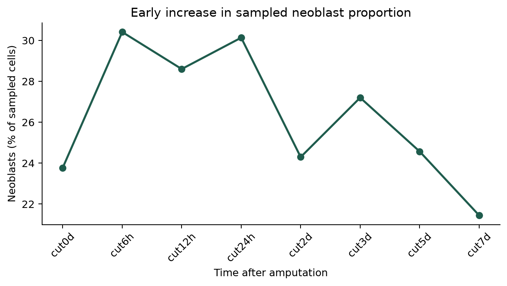
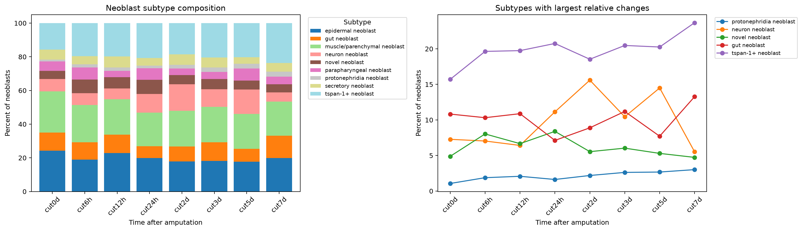
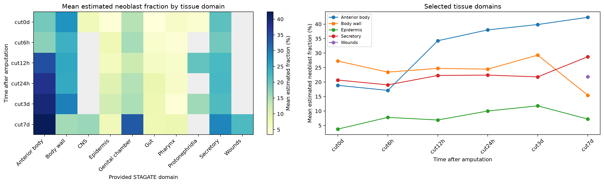
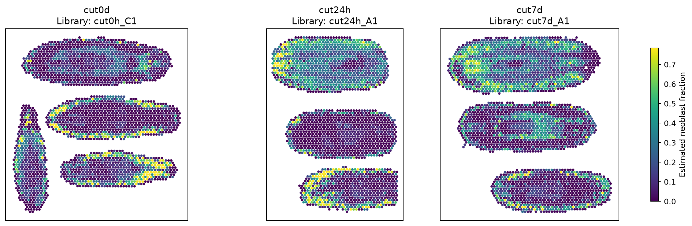

# Neoblast dynamics during planarian regeneration

**Miantong Zhang · STAT 530 course project · May 2026**

An exploratory reanalysis of published single-cell RNA-seq and Visium spatial
transcriptomics data from *Schmidtea mediterranea*. The project asks how neoblast
composition changes over regeneration, whether annotated subtypes have distinct
marker profiles, and where **overall neoblast abundance** is represented in tissue.

**Main observation:** sampled neoblast proportions rise early after amputation,
subtype composition varies over time, and estimated neoblast fractions differ
across spatial tissue domains. These descriptive associations motivate hypotheses
about regeneration; they do not establish lineage transitions or causal mechanisms.

## Research questions and methods

| Question | Data and method | Main observation |
| --- | --- | --- |
| Does overall neoblast representation change? | Count supplied major-cell-type labels in 55,014 scRNA-seq profiles across eight time points. | Neoblasts constitute 23.8% at baseline, 30.4% at 6 h, 30.1% at 24 h, and 21.4% at day 7. |
| Which annotated subtypes change? | Within-neoblast composition of 14,601 cells, baseline-relative fold changes, stacked bars and time curves. | Neuronal-biased neoblasts peak at day 2 (15.6%); tspan-1+ neoblasts reach 23.7% at day 7. |
| Do subtypes have distinct marker profiles? | Scanpy Wilcoxon subtype-vs-rest ranking, BH correction, top-five markers for five selected subtypes, and supplied BLAST-symbol lookup. | Distinct expression patterns support transcriptionally different subtype states; human-symbol matches provide tentative interpretation. |
| Where is the overall neoblast signal represented? | Normalize supplied cell2location abundances within each Visium spot; summarize by supplied STAGATE domain and plot spatial coordinates at six time points. | The anterior-body domain increases from 18.9% to 42.3%; body-wall and secretory domains also show relatively high estimates. |

Single-cell time points: 0 h, 6 h, 12 h, 24 h, 2 d, 3 d, 5 d, 7 d.
Visium time points: 0 h, 6 h, 12 h, 24 h, 3 d, 7 d.

## Selected results

### Overall temporal response



### Subtype composition



### Tissue-domain context



### Representative spatial maps



The spatial panels show the library with the most spots at each selected time point.
A library may contain multiple tissue profiles. These are examples, not registered
longitudinal images of the same animal. All libraries contribute to the domain summaries.
Gray heatmap entries indicate unavailable domain/time combinations, not zero abundance.
The [marker panel](results/figures/03_marker_expression.png) and all numerical outputs
are also available under [results/](results/).

## Run the project

The repository includes compact, study-derived tables, so the main figures can be
regenerated without downloading several gigabytes of expression matrices.

```bash
git clone https://github.com/MTong-Z/planarian-neoblast-regeneration.git
cd planarian-neoblast-regeneration
uv sync --frozen
uv run python scripts/run_analysis.py
uv run python scripts/validate_results.py
```

Python 3.11 is specified in `.python-version`; `uv.lock` records the tested dependency
resolution. With an existing Python 3.11–3.13 environment, `python -m pip install -e .`
is an alternative. Figures and CSV tables are written to `results/`.

Read the executed [analysis notebook](notebooks/neoblast_regeneration.ipynb) or
download the [HTML report](reports/neoblast_regeneration.html) for a standalone view.
To execute the notebook locally:

```bash
uv run jupyter nbconvert --to notebook --execute --inplace \
  --ExecutePreprocessor.timeout=600 notebooks/neoblast_regeneration.ipynb
```

The default workflow recomputes composition and spatial summaries from compact
inputs, and redraws the marker panel from exported marker summaries. **It does not
rerun gene-level marker discovery.** The full-expression workflow is documented in
[Data and reproducibility](docs/DATA.md).

## Repository contents

```text
data/processed/     Compact cell/spot tables, marker summaries, and provenance
docs/DATA.md       Official downloads, expected file layout, and data dictionary
notebooks/         Executed analysis notebook
reports/           Exported standalone HTML report
results/figures/   Five result panels
results/tables/    Numerical summaries underlying the figures
scripts/           Data preparation, marker computation, analysis, and validation
src/               Reusable analysis and legacy-H5AD reader code
uv.lock            Locked Python environment
```

## Contributions and interpretation

This repository organizes my STAT 530 course analysis into a reproducible portfolio
project. The study authors generated the data and supplied the cell annotations,
neoblast subtype labels, STAGATE tissue labels, and cell2location abundance estimates.
My analysis connects four biological questions using composition summaries,
subtype-vs-rest marker ranking, tissue-domain comparisons, and visualizations.
STAGATE and cell2location were **not retrained** in this project.

### Data-quality correction in the repository edition

The supplied scaled neoblast matrix contains invalid or inconsistent values in
175 of 14,601 profiles. The repository recovers those profiles from the matching
published count matrix using the study's normalization/log/scaling recipe and the
stored gene-level mean and standard deviation. On the other **14,426 profiles**, the
reconstructed values agree within **1.91 × 10⁻⁶**; those profiles are retained as
supplied. The source files are unchanged. Marker results and the marker panel in
this repository are recomputed after this correction; composition and spatial
analyses retain the original labels and estimates. See the
[recovery audit](data/processed/matrix_recovery.json) and [workflow](docs/DATA.md).

## Limitations

- **Relative composition:** changes in sampled cell fractions do not establish
  changes in absolute cell number, proliferation, activation, or cell fate. Subtype
  fractions use all neoblasts as their denominator, unlike the overall-cell analysis.
- **Descriptive comparisons:** time points and spatial spots are pooled without
  replicate-level uncertainty estimates or differential-abundance tests. Cells and
  neighboring spots are not independent biological replicates. Domain averages are
  spot-weighted and can be affected by sampling and tissue composition.
- **Subtype identity:** existing annotations and marker differences support distinct
  expression states but do not constitute lineage tracing or functional validation.
  Supplied human BLAST symbols are tentative annotations, not verified orthology.
- **Processed expression:** the supplied neoblast matrix retains 3,000 genes and
  contains negative values. Marker ranks are exploratory; log-fold-change estimates
  are excluded. Marker-panel dot size denotes values above zero in the supplied
  matrix, **not the fraction of cells with detected transcripts**. This label is
  clarified from the original course plot.
- **Spatial resolution:** only overall `cell2location_Neoblast` is supplied, with no
  separate estimates for individual neoblast subtypes. These model-derived fractions
  are not direct cell counts. The spatial analysis cannot locate each subtype or
  directly connect a subtype's time course to its tissue destination.
- **Temporal interpretation:** these are cross-sectional samples, not tracking of
  the same cells or animals. Spatial maps are illustrative and use a shared scale
  capped at the pooled 98th percentile for readability.

## Data source and citation

Cui, G. et al. (2023). *Spatiotemporal transcriptomic atlas reveals the dynamic
characteristics and key regulators of planarian regeneration.* Nature Communications
14, 3205. [doi:10.1038/s41467-023-39016-0](https://doi.org/10.1038/s41467-023-39016-0).

- [Processed data: OMIX003867](https://ngdc.cncb.ac.cn/omix/release/OMIX003867)
- [Study code](https://github.com/yangteam/Spatiotemporal-transcriptomic-atlas-of-planarian-regeneration)
- [Study resource: STAPR](https://ngdc.cncb.ac.cn/STAPR/)

The article, study data, and upstream code retain their respective terms. This
repository does not claim ownership of the upstream datasets or annotations.
